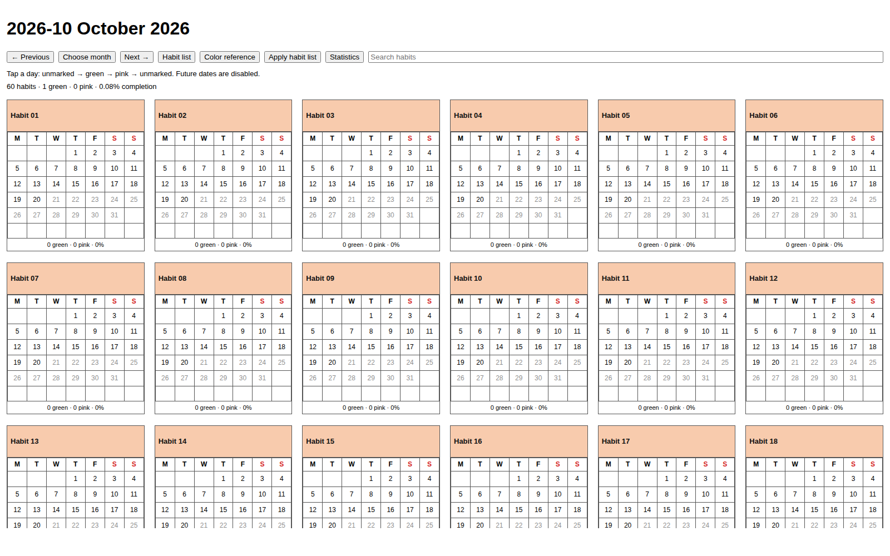
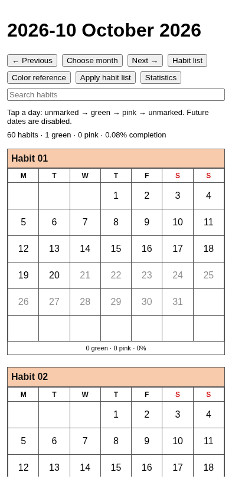

# Habit Calendar 001b

Monthly habit calendars for Obsidian by **harharhari**. Version **1.1.1**, licensed under **GPL-3.0-only**.

Track daily activities with a named calendar for each habit. Wide desktop views show six calendars per row; Android shows one. Click or tap a date to cycle **unmarked → green → pink → unmarked**. Weeks start Monday. The monthly title follows `2026-10 October 2026`.

## Layout examples

These browser-rendered examples use generic habits and mocked Obsidian APIs; they are not device screenshots.





## Download and install

Download the assets from [GitHub Releases](https://github.com/harharhari/rsn-habit-tracker-obsidian-plugin/releases/tag/1.1.1). This link becomes available when the maintainer publishes the release and grants access. The repository may remain private during testing.

1. Back up your vault. Use `rsn-test-vault` for the first trial.
2. Download the six release assets and verify them on Linux with `sha256sum -c SHA256SUMS`.
3. Close Obsidian. Extract `habit-calendar-001b-1.1.1.zip` and copy its `habit-calendar-001b` folder into `<vault>/.obsidian/plugins/`. For an upgrade, overwrite the four program/reference files inside the existing folder and preserve `data.json`.
4. Reopen Obsidian. Under Settings → Community plugins, allow community plugins and enable **Habit Calendar 001b**.
5. Run **Habit Calendar 001b: Open current month** in the command palette. A new vault starts with an empty habit list. Follow the tutorial to add your own rows.

Use the individually attached installation ZIP, not GitHub's automatically generated Source code ZIP. No Node.js or Python is required for normal use. Android manual installation requires a vault in accessible device storage.

After Community acceptance, users can instead search for **Habit Calendar 001b** by **harharhari** in Settings → Community plugins → Browse, then install and enable it. This package does not claim directory acceptance.

## Habit list and colors

Edit `Habit Tracker/habit-tracker-list.md`:

```markdown
| Habit | Generate calendar | Header color |
|---|---|---|
| Walking | Y | #90EE90 |
| Reading | Y | #ADD8E6 |
| Yoga | N | #FFDAB9 |
```

Y displays a calendar, N excludes it when you apply the list. Keep the hidden habit-ID comments that the plugin adds. Copy a six-digit hex code from `Habit Tracker/hex-color-list.md`, which has 147 CSS3 colors and supports custom rows. View the color note in Reading view to see its swatches.

**Applying a habit-list change with Yes clears every current-month mark**, including marks for unchanged habits. No keeps the displayed month and marks unchanged, while leaving your edited list in place. Use Apply habit list to reconsider a declined change. Previous months stay read-only and keep their saved statistics and calendar snapshot. Late synced entries do not alter frozen history.

## Monthly behaviour

Earlier dates within the current month are editable. Future dates are disabled. Completion uses green days divided by elapsed calendar days; pink and blank dates break month-local streaks. There are no schedules or automatic missed-day marks.

A new month appears while Obsidian is running, or on its next opening. The optional Linux helper supports desktop scheduling. There is no Android background scheduler. The initial timezone is Asia/Kolkata; keep `Habit Tracker/System/config.md` consistent across devices.

## Guides

- [Ubuntu and Android tutorial (PowerPoint)](docs/Habit-Calendar-001b-Tutorial.pptx)
- [First-use tutorial](docs/TUTORIAL.md)
- [Install, upgrade and download guide](docs/INSTALL-DOWNLOAD.md)
- [Android and optional Sync](docs/ANDROID-rsn-test-vault.md)
- [Maintainer testing and Community submission](docs/GITHUB-AND-COMMUNITY-RELEASE.md)
- [Acceptance checklist](docs/TESTING-CHECKLIST.md) and [test evidence](docs/VALIDATION.md)
- [Final design and open questions](docs/DESIGN-DECISIONS.md)
- [Exact repository inventory](docs/FILES-TO-PUSH.md)

## Compatibility and data

The maintainer reports 1.1.1 working on Ubuntu laptop and Android phones on 21 October 2026. Exact device/app versions are not yet recorded. Windows, macOS and iOS are intended targets, not verified in this release record. `minAppVersion` is 1.7.2 based on API linting; device testing on that minimum is still required before claiming it as a tested floor.

No plugin network requests, telemetry, external accounts or runtime dependencies. Community plugins execute with Obsidian's privileges. Sync is a separate service, not supplied by this plugin. Obsidian Sync is optional and paid. Keep a backup, sync before rollover, and perform list resets on one device after syncing. Simultaneous resets can discard each other's revisions.

Preserve `Habit Tracker/` and plugin `data.json` when upgrading. Keep Statistics and System if deleting older pages or records. Disable Habit Calendar 001 on every device before using 001b with the same data; 001 does not understand reset records.

## Build

Developers need Node.js 22+ with npm. Python 3.9+ is needed only for helper tests.

```bash
npm ci --ignore-scripts
npm run check
npm run test:helper
```

`npm run build` is the production build command. `npm run check` runs official Obsidian ESLint checks, builds, tests, verifies metadata and creates the six release assets under `release/`. GitHub Actions runs these checks on pushes and pull requests. It does not publish a release.

Repository-root `SHA256SUMS` verifies this prepared source snapshot. The separate release `SHA256SUMS` verifies the four loose installation files and installation ZIP. These are different inventories. See [checksum instructions](docs/CHECKSUMS.md).

## Support and license

Report reproducible problems through [GitHub Issues](https://github.com/harharhari/rsn-habit-tracker-obsidian-plugin/issues). Include plugin/app versions, OS, steps and error text, but remove personal vault content. [GPL-3.0-only](LICENSE). Copyright © 2026 harharhari. See [NOTICE](NOTICE).

Compatibility clarification: Ubuntu **24.04.3**. The user assumes the latest Obsidian version on each platform and latest Android; exact app/Android versions and phone models were not recorded. This is an assumption, not a verified numerical version.
