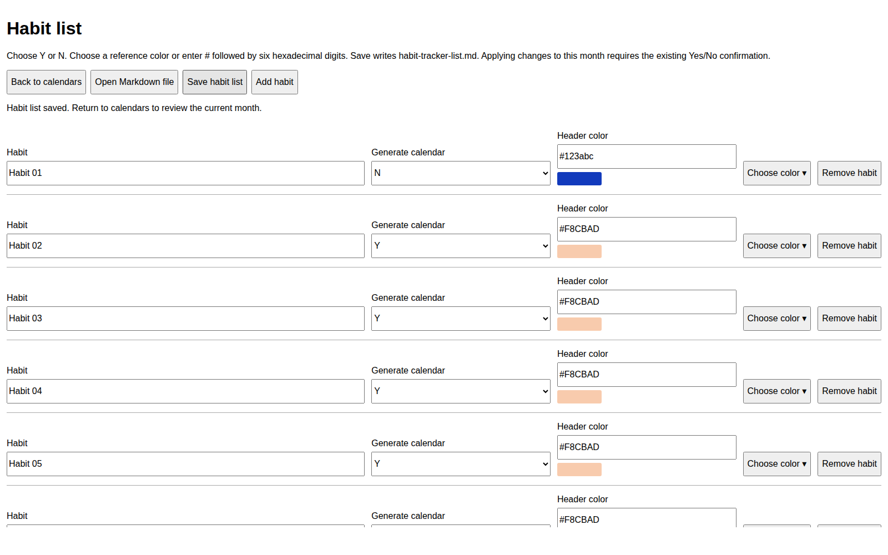
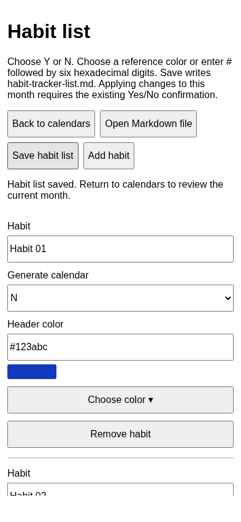
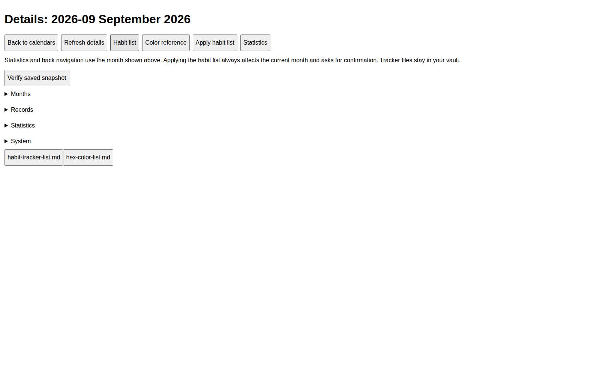

> Upgrading from Habit Calendar 001b 1.1.1/1.1.2: follow [MIGRATION-1.1.3.md](MIGRATION-1.1.3.md) first. The ID and installation folder change. Disable the old plugin on all devices and copy wanted settings before enabling the new one.

For repository cleanup, manual-kit distribution and existing-release handling, follow [the deployment update guide](DEPLOYMENT-UPDATE-GUIDE.md). Do not delete the whole repository or upload the outer handoff directories as source.

# rsn habit calendar one b — first-use tutorial

Version 1.1.7 · harharhari · GPL-3.0-only

This tutorial uses two habits in a separate test vault. Installation and migration are covered in [Setup and use](SETUP-AND-USAGE.md). The test checklist is [here](TESTING-CHECKLIST.md).

## 1. Open your first month

Enable rsn habit calendar one b. Press Ctrl+P on Linux/Windows or Command+P on macOS and run **rsn habit calendar one b: Open current month**. On mobile use the command palette. For October 2026 the title is **2026-10 October 2026**. A new empty vault initially has no habit calendars.

## 2. Open the habit editor

Click **Details** on the calendar toolbar, then **Habit list**. This opens the plugin editor. Click **Add habit** three times and enter these examples:

| Habit | Generate calendar | Header color |
|---|---|---|
| Walking | Y | #90EE90 |
| Reading | Y | #ADD8E6 |
| Yoga | N | #FFDAB9 |

Choose Y or N using each row's dropdown. Enter a six-digit hex code directly, or click **Choose color ▾**, search a color name or hex code, and select the row showing its name, code and swatch. The color chooser works on desktop and mobile. Invalid values show an error and cannot be saved. Color names alone, shorthand #RGB, alpha colors and blank colors are not accepted.

## 3. Save and apply

Click **Save habit list**. The editor saves habit-tracker-list.md and preserves existing stable IDs. A meaningful change immediately offers the current-month replacement confirmation. Save before closing the editor. **Open Markdown file** remains available for advanced editing and reordering whole rows.

The warning says:

> The current months entries will be overwritten and there would be loss of data

For this new empty month choose **Yes**. Two calendars appear: Walking and Reading. Yoga is not displayed because its flag is N. Desktop shows up to six calendars per row; mobile shows one.

## 4. Record activity

Click today's date in Walking once: green. Click it again: pink. Click a third time: unmarked. You can populate earlier dates in the current month. Future dates and previous months cannot be edited.

Mark a few dates, open **Details → Statistics**, then restart Obsidian and verify the entries persisted. Completion is green days divided by elapsed calendar days, without schedules. Blank/pink days break streaks.

## 5. Practise No before Yes

Edit Walking's header code to #FFDAB9, keeping its habit-ID comment. Save. Choose **No** in the warning.

The current calendar retains its old header and marks. Your edited habit-list file remains edited; No does not undo the text edit. The same declined edit is not prompted every minute. Click **Details → Apply habit list** to reconsider it.

Now choose **Yes**. Both current calendars are rebuilt and ALL current-month marks disappear, including Reading's marks even though you changed only Walking. The current statistics restart accordingly. A pre-reset recovery snapshot is retained under `Habit Tracker/System/Backups/`; there is no one-click undo.

Use one deliberate batch of list edits to avoid repeated resets. Finish sync before replacing a month and let the replacement sync before marking on another device.

## 6. Add a custom color

In Source mode, append this row to the existing color-reference table:

```markdown
| My lavender | #B8A9E8 | |
```

Return to Reading view. The plugin paints the blank third cell using the Hex Code column. Reopen the habit editor to load the new reference row. Choose My lavender from the color chooser, or type #B8A9E8 directly. Applying that habit-list change requires the same destructive Yes/No confirmation. Your custom color row itself survives refresh and upgrades.

## 7. Add, hide, delete, reorder, or rename habits

- Add a row with Y to include a new calendar.
- Change Y to N or delete a row to remove its current calendar after confirmation.
- Move whole rows to change calendar order.
- Rename the visible name while preserving the hidden ID comment.

Every meaningful catalog change prompts before changing the current month. Yes always resets the entire current month. No leaves the active month intact. Whitespace-only table formatting does not reset anything.

## 8. Review previous months

Use Previous or Choose month. The last saved historical report and calendar are frozen; current list edits and late synced entries cannot change them. Prior days are read-only. A frozen report keeps its saved as-of date, even if that date was before month-end.

If an older 001 archive no longer has its original detail records, only its retained totals may be available. Do not infer missing history from the current habit list.

## 9. Start a new month

When Obsidian is running on the first, or first opens afterward, the new month uses the then-current habit list. This includes edits for which you chose No in the previous month. New marks start blank. Previous months remain frozen.

Generation while Obsidian is closed requires the optional Linux helper described in SETUP-AND-USAGE.md, with the computer running. It is not required for ordinary plugin use.

## 10. Keep data and backups

Retain `Habit Tracker/Statistics/` and `Habit Tracker/System/`. Only purge older monthly pages or detail records after checking their frozen snapshots and backups. Disabling or uninstalling the plugin leaves your vault data in place.

When migrating from 001, disable it on EVERY device before enabling 001b. Both variants use the same data directory, but 001 cannot interpret 001b reset records.

## 11. Windows, Mac, iPhone and iPad

Installation for all platforms is in INSTALL-DOWNLOAD.md. Desktop commands use Ctrl+P on Windows/Ubuntu and Command+P on Mac. Phone/tablet users open the command palette from the ribbon/menu. Choose month now offers a month dropdown and four-digit year; no browser-specific month input is required. iPad retains one column, including landscape. Narrow desktop split panes also switch to one column. See the updated PowerPoint for platform-specific walkthroughs.

## Details and direct calendar access

Click **Details** to open the separate tracker page. Expand Months, Records, Statistics or System, then click a filename to open it. The habit-tracker-list.md and hex-color-list.md buttons open their raw notes. Back to calendars returns to the month shown on Details. Statistics uses that same month. Apply habit list always targets the current month. This page does not move files. The file explorer hides Records, Statistics, System, habit-tracker-list.md and hex-color-list.md only under Habit Tracker. Months remains visible. There is no plugin Welcome page.

## Save conflicts and invalid older lists

If the list changes on disk or through sync while the editor is open, Save reports a conflict and preserves the newer file. Copy your unsaved edits before closing and reopening the editor. If an older list has invalid hex values, use Open Markdown file to correct them, then Reload editor. Names must be unique, 1–180 characters, without pipes, newlines or HTML comments. Removed rows remain a draft until Save; all current marks reset only after Yes.

## Editor examples

These screenshots come from the Chromium test harness with mocked Obsidian APIs. Your Obsidian theme changes their appearance.





The editable navigation diagram is navigation.drawio.

## Version 1.1.7 navigation exercise

1. Run Open current month. Confirm only Previous, Choose month, Next and Details appear in the main toolbar, with Search habits still available.
2. Open an existing previous month and click Details. Its heading must show that month.
3. Click Statistics to open that month's retained report. Return to Details and use Back to calendars to reopen the same month.
4. On Details, use Habit list for the editor, Color reference for the color note, or Apply habit list to reconsider a saved change. Apply always targets the current month, even when Details displays history. No preserves current marks; Yes clears all current-month marks.
5. In the file explorer expand Habit Tracker. Months remains visible; Records, Statistics, System and the two reference notes are hidden. They remain accessible through Details and stay included in sync and backup.
6. Disable the plugin briefly in a test vault. The five explorer entries should reappear. Re-enable and run Open current month. Do not delete hidden folders to simplify the interface.


